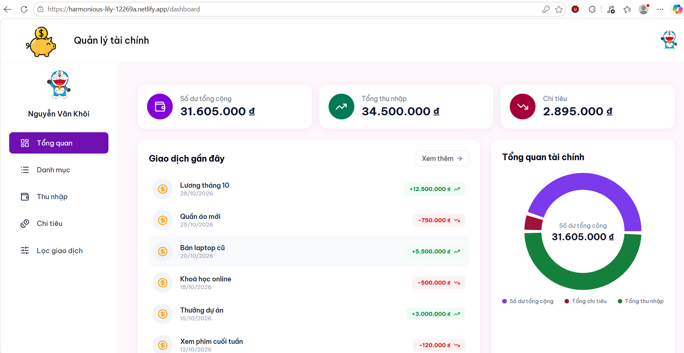
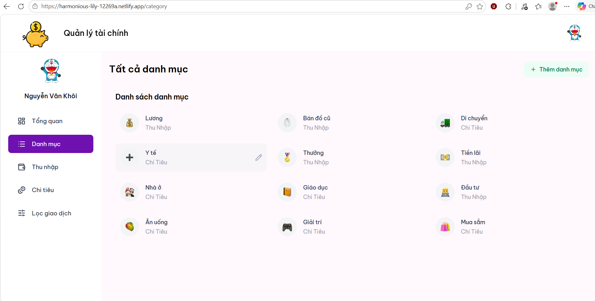

<div align="center">

# 💰 Hệ thống Quản lý Tài chính Cá nhân

**Personal Finance Management System** — Ứng dụng web quản lý thu chi cá nhân, thống kê trực quan và xuất báo cáo Excel.

<a href="https://spring.io/projects/spring-boot">
  
</a>
<a href="https://www.java.com/">
  
</a>
<a href="https://react.dev/">
  
</a>
<a href="https://vite.dev/">
  
</a>
<br>
<a href="https://tailwindcss.com/">
  
</a>
<a href="https://www.postgresql.org/">
  
</a>
<a href="https://jwt.io/">
  
</a>
<a href="https://www.docker.com/">
  
</a>

</div>

---
Link demo: https://harmonious-lily-12269a.netlify.app
## 🔑 Tài khoản Demo

Trải nghiệm ngay sản phẩm với tài khoản dùng thử (dữ liệu kết nối tới API đã triển khai trên Render):

<table>
<tr><td align="center"><b>👤 Username</b></td><td align="center"><code>khoi123</code></td></tr>
<tr><td align="center"><b>🔒 Password</b></td><td align="center"><code>Password147@</code></td></tr>
</table>

## 📖 Giới thiệu

**Hệ thống Quản lý Tài chính Cá nhân** là ứng dụng web giúp người dùng ghi nhận, theo dõi và phân tích toàn bộ dòng tiền cá nhân — từ các khoản thu nhập, chi tiêu hằng ngày đến báo cáo tổng quan tài chính.

### ❓ Vấn đề cần giải quyết

Việc ghi chép thu chi bằng sổ tay hoặc bảng tính thủ công thường bị phân tán, dễ bỏ sót và khó trả lời các câu hỏi đơn giản như: *"Tháng này tôi tiêu bao nhiêu?", "Tiền đi đâu rồi?", "Số dư còn lại là bao nhiêu?"*. Dự án được xây dựng để **số hóa toàn bộ quy trình này**:

- Ghi nhận nhanh từng khoản thu/chi theo danh mục riêng.
- Tự động tổng hợp số dư, tổng thu nhập, tổng chi tiêu.
- Trực quan hóa xu hướng tài chính bằng biểu đồ.
- Tra cứu giao dịch linh hoạt và xuất báo cáo Excel.

### 👥 Đối tượng người dùng

- Cá nhân, sinh viên, người đi làm muốn quản lý tài chính cá nhân hằng ngày.
- Bất kỳ ai cần một công cụ đơn giản để nắm rõ thu — chi — số dư của chính mình.


## ✨ Chức năng chính

### 🔐 Xác thực & Hồ sơ

| Chức năng | Mô tả |
|---|---|
| **Đăng ký tài khoản** | Tạo tài khoản với họ tên, tên đăng nhập và mật khẩu mạnh (≥ 8 ký tự, gồm chữ hoa, chữ thường, số và ký tự đặc biệt) — được kiểm tra cả ở client và server |
| **Đăng nhập bằng JWT** | Xác thực stateless, token lưu an toàn phía client và tự động đính kèm vào mỗi request |
| **Tự động đăng xuất** | Khi token hết hạn hoặc không hợp lệ (HTTP 401), người dùng được chuyển về màn hình đăng nhập |
| **Hồ sơ cá nhân** | Cập nhật họ tên và ảnh đại diện — ảnh được tải lên và lưu trữ qua Cloudinary |

### 📊 Tổng quan (Dashboard)

| Chức năng | Mô tả |
|---|---|
| **Thẻ thống kê** | Hiển thị **Số dư tổng cộng**, **Tổng thu nhập** và **Chi tiêu** ngay đầu trang |
| **Biểu đồ donut** | Tỷ lệ trực quan giữa số dư — thu nhập — chi tiêu, có tooltip chi tiết theo từng phần |
| **Giao dịch gần đây** | Gộp 5 khoản thu và 5 khoản chi mới nhất, sắp xếp theo ngày |
| **Danh sách nhanh** | Khung xem riêng "Chi tiêu gần đây" và "Thu nhập gần đây" với nút chuyển nhanh sang trang tương ứng |

### 💰 Thu nhập

| Chức năng | Mô tả |
|---|---|
| **Thêm khoản thu** | Nhập tên, số tiền (hỗ trợ định dạng tiền Việt), ngày, icon và danh mục; có kiểm tra dữ liệu hợp lệ |
| **Xóa khoản thu** | Xóa với hộp thoại xác nhận, danh sách cập nhật tức thì |
| **Biểu đồ xu hướng** | Biểu đồ vùng (area chart) thể hiện các khoản thu theo thời gian |
| **Xuất Excel** | Tải danh sách thu nhập dạng file `.xlsx` (cột: STT, Tên, Danh mục, Số tiền, Ngày) |

### 💸 Chi tiêu

| Chức năng | Mô tả |
|---|---|
| **Thêm khoản chi** | Tương tự khoản thu: tên, số tiền, ngày (không vượt quá hôm nay), icon, danh mục |
| **Xóa khoản chi** | Xóa an toàn với bước xác nhận |
| **Biểu đồ xu hướng** | Biểu đồ vùng theo dõi dòng tiền chi tiêu theo thời gian |
| **Xuất báo cáo Excel** | Tải báo cáo chi tiêu được định dạng màu sắc, tiêu đề rõ ràng |

### 🗂️ Danh mục

| Chức năng | Mô tả |
|---|---|
| **Tạo danh mục** | Đặt tên, chọn loại (thu nhập/chi tiêu) và icon emoji từ bộ chọn tích hợp |
| **Chỉnh sửa danh mục** | Cập nhật tên, loại và icon của danh mục đã có |
| **Chống trùng lặp** | Cảnh báo khi tên danh mục đã tồn tại |
| **Phân loại theo loại** | Lấy danh mục riêng cho khoản thu hoặc khoản chi khi nhập giao dịch |

### 🔍 Lọc giao dịch

| Chức năng | Mô tả |
|---|---|
| **Lọc đa điều kiện** | Kết hợp loại giao dịch (thu/chi), khoảng thời gian và từ khóa tìm kiếm |
| **Sắp xếp linh hoạt** | Theo ngày, số tiền hoặc tên — tăng dần/giảm dần |
| **Tìm kiếm thông minh** | Từ khóa có debounce 400ms, tránh gọi API dư thừa khi đang gõ |
| **Kết quả tức thời** | Danh sách tự cập nhật khi thay đổi điều kiện, hiển thị số lượng kết quả và các trạng thái rỗng/lỗi thân thiện |

---

## 🖼️ Giao diện sản phẩm

### 📊 Tổng quan — Dashboard

Trang chủ hiển thị thẻ thống kê tài chính, biểu đồ donut tổng quan, giao dịch gần đây và hai danh sách thu — chi mới nhất.



--- 

### 💰 Quản lý Thu nhập & Chi tiêu

Biểu đồ vùng theo dõi xu hướng, danh sách giao dịch đầy đủ, thêm/xóa nhanh bằng modal và tải báo cáo Excel.

| Thu nhập | Chi tiêu |
|:---:|:---:|
|  |  |

---

### 🗂️ Danh mục & 🔍 Lọc giao dịch

Quản lý danh mục thu chi với icon emoji; tra cứu giao dịch theo loại, thời gian, từ khóa và sắp xếp đa tiêu chí.

| Danh mục | Lọc giao dịch |
|:---:|:---:|
|  |  |

---

## 🛠️ Công nghệ sử dụng

### ⚛️ Frontend

| Công nghệ | Vai trò |
|---|---|
|  **React 19** | Thư viện xây dựng giao diện người dùng |
|  **Vite** | Build tool & dev server cực nhanh, hỗ trợ HMR |
|  **Tailwind CSS 4** | Framework CSS utility-first, thiết kế responsive |
| **Recharts** | Vẽ biểu đồ donut (dashboard) và biểu đồ vùng (thu nhập/chi tiêu) |


### ☕ Backend

| Công nghệ | Vai trò |
|---|---|
|  **Java 21** | Ngôn ngữ lập trình chính |
|  **Spring Boot 4.1.1** | Framework backend, cấu hình tự động |
| **Spring Web MVC** | Xây dựng các REST API controller |
| **Spring Data JPA (Hibernate)** | Tầng ORM, truy vấn cơ sở dữ liệu qua repository |
| **Lombok** | Giảm boilerplate code (getter/setter/builder) |
| **Apache POI 5.2.5** | Tạo và xuất file Excel (.xlsx) có định dạng |
| **Maven** | Quản lý dependency và build backend |

### 🗄️ Database

| Công nghệ | Vai trò |
|---|---|
|  **PostgreSQL** | Hệ quản trị CSDL quan hệ lưu người dùng, danh mục, thu nhập và chi tiêu |

### 🔐 Authentication & Security

| Công nghệ | Vai trò |
|---|---|
| **Spring Security** | Bộ lọc bảo mật, phân quyền request stateless |
| **JJWT 0.11.5** | Sinh và xác thực JSON Web Token |
| **BCrypt** | Băm mật khẩu an toàn trước khi lưu |
| **JwtRequestFilter** | Chặn và kiểm tra token cho mọi request cần xác thực |
| **CORS Configuration** | Cho phép frontend giao tiếp an toàn với backend |
| **Password Validator** | Ép buộc chính sách mật khẩu mạnh khi đăng ký |


### 📋 Yêu cầu môi trường

- **Java 21** (JDK)
- **Maven** (dự án đã kèm Maven Wrapper)
- **Node.js** ≥ 18 và **npm**
- **PostgreSQL** đang chạy


## 🗂️ Cấu trúc dự án

```text
financial-new/
├── Ảnh/                        # Screenshots giao diện sản phẩm
├── backend/                    # Spring Boot REST API
│   ├── src/main/java/com/financial/financialmanager/
│   │   ├── config/             # Cấu hình Spring Security & CORS
│   │   ├── controller/         # REST controllers
│   │   ├── dto/                # Data Transfer Objects
│   │   ├── entity/             # JPA entities
│   │   ├── repository/         # Spring Data repositories
│   │   ├── security/           # JWT filter & utility
│   │   ├── service/            # Business logic
│   │   └── util/               # Password validator
│   ├── src/main/resources/     # application.properties & migration
│   ├── Dockerfile
│   └── pom.xml
└── frontend/                   # React SPA (Vite)
    ├── src/
    │   ├── components/         # Dashboard, forms, lists, modals...
    │   ├── pages/              # Home, Income, Expense, Category, Filter, Login, Signup
    │   ├── context/            # App context (user state)
    │   ├── hooks/              # Custom hooks
    │   └── util/               # API endpoints, axios config, helpers
    └── package.json
```

---

<div align="center">

### Được xây dựng với ❤️ bằng Spring Boot & React

</div>
